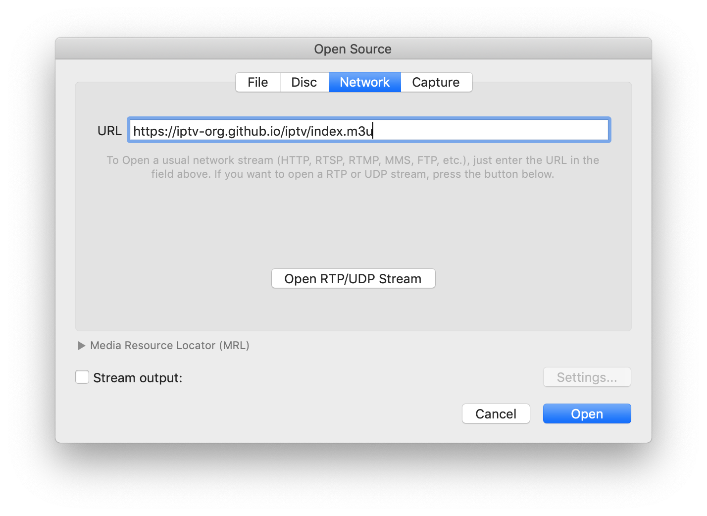

# IPTV [](https://github.com/zkkm2580/iptv-playlist/actions/workflows/update.yml)

Collection of publicly available IPTV (Internet Protocol television) channels from all over the world.

## Table of contents

- 🚀 [How to use?](#how-to-use)
- 📺 [Playlists](#playlists)
- 🗓 [EPG](#epg)
- 🗄 [Database](#database)
- 👨‍💻 [API](#api)
- 📚 [Resources](#resources)
- 💬 [Discussions](#discussions)
- ❓ [FAQ](#faq)
- 🛠 [Contribution](#contribution)
- ⚖ [Legal](#legal)
- © [License](#license)

## How to use?

Simply insert one of the links below into [any video player](https://github.com/iptv-org/awesome-iptv#apps) that supports live streaming and press _Open_.



## Playlists

There are several versions of playlists that differ in the way they are grouped. As of January 30th, 2024, we have stopped distributing NSFW channels. For more information, please look at [this issue](https://github.com/iptv-org/iptv/issues/15723).

### Main playlist

This playlist includes all known channels available in this repository.

```
https://zkkm2580.github.io/iptv-playlist/index.m3u
```

### Grouped by category

<details>
<summary>Expand</summary>
<br>

Playlist in which each channel has its _category_ as a group title:

```
https://zkkm2580.github.io/iptv-playlist/index.category.m3u
```

Same thing, but split up into separate files:

<!-- prettier-ignore -->
#include "./.readme/_categories.md"

</details>

### Grouped by language

<details>
<summary>Expand</summary>
<br>

Playlist in which each channel has its _language_ as a group title:

```
https://zkkm2580.github.io/iptv-playlist/index.language.m3u
```

Same thing, but split up into separate files:

<!-- prettier-ignore -->
#include "./.readme/_languages.md"

</details>

### Grouped by country

<details>
<summary>Expand</summary>
<br>

Playlist in which each channel has its _country_ as a group title:

```
https://zkkm2580.github.io/iptv-playlist/index.country.m3u
```

Same thing, but split up into separate files:

<!-- prettier-ignore -->
#include "./.readme/_countries.md"

</details>

### Grouped by region

<details>
<summary>Expand</summary>
<br>

Playlist in which each channel has its _region_ as a group title:

```
https://zkkm2580.github.io/iptv-playlist/index.region.m3u
```

Same thing, but split up into separate files:

<!-- prettier-ignore -->
#include "./.readme/_regions.md"

</details>

## EPG

[Electronic Program Guide](https://en.wikipedia.org/wiki/Electronic_program_guide) for most of the channels can be downloaded using utilities published in the [iptv-org/epg](https://github.com/iptv-org/epg) repository.

## Database

All channel data is taken from the [iptv-org/database](https://github.com/iptv-org/database) repository. If you find any errors please open a new [issue](https://github.com/iptv-org/database/issues) there.

## API

The API documentation can be found in the [zkkm2580/api](https://github.com/zkkm2580/api) repository.

## Resources

Links to other useful IPTV-related resources can be found in the [iptv-org/awesome-iptv](https://github.com/iptv-org/awesome-iptv) repository.

## Discussions

If you need help finding a channel, have a question or idea, welcome to the [Discussions](https://github.com/orgs/iptv-org/discussions).

## FAQ

The answers to the most popular questions can be found in the [FAQ.md](FAQ.md) file.

## Contribution

Please make sure to read the [Contributing Guide](CONTRIBUTING.md) before sending an issue or making a pull request.

And thank you to everyone who has already contributed!

### Backers

<a href="https://opencollective.com/iptv-org"></a>

### Contributors

<a href="https://github.com/zkkm2580/iptv-playlist/graphs/contributors"></a>

## Legal

No video files are stored in this repository. The repository simply contains user-submitted links to publicly available video stream URLs, which to the best of our knowledge have been intentionally made publicly by the copyright holders. If any links in these playlists infringe on your rights as a copyright holder, they may be removed by sending a [pull request](https://github.com/zkkm2580/iptv-playlist/pulls) or opening an [issue](https://github.com/zkkm2580/iptv-playlist/issues/new?assignees=freearhey&labels=removal+request&template=--removal-request.yml&title=Remove%3A+). However, note that we have **no control** over the destination of the link, and just removing the link from the playlist will not remove its contents from the web. Note that linking does not directly infringe copyright because no copy is made on the site providing the link, and thus this is **not** a valid reason to send a DMCA notice to GitHub. To remove this content from the web, you should contact the web host that's actually hosting the content (**not** GitHub, nor the maintainers of this repository).

## License

[](LICENSE)
